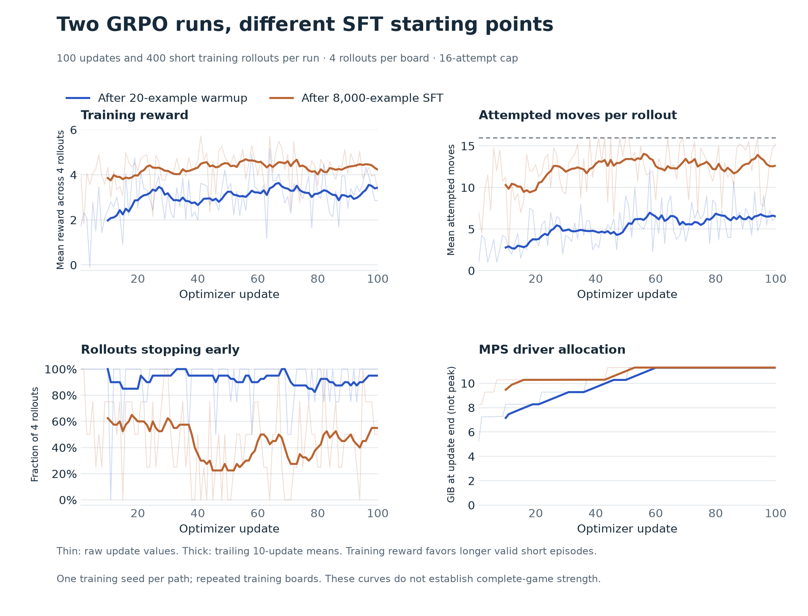

# 2048 post-training lab

Learn post-training end to end by teaching a small language model to play 2048.

**Local training is complete:** all 8,000 SFT examples, 2,000 SFT updates, and
100 post-SFT GRPO updates on the Mac. The separate warmup-GRPO comparison also
finished. See the [final report, plots and merged export](docs/FULL_LOCAL_TRAINING.md).

The experiment is **solver demonstrations → SFT → online GRPO → game evaluation**.
A frozen Strands Decider adviser is a conditional comparison, after measuring
whether it gives useful 2048 advice.

## Seven steps

1. Build and verify a seeded simulator and baseline players locally.
2. Generate solver-labeled demonstrations and verify the data locally.
3. Benchmark Strands Decider on the Mac.
4. Train a LoRA SFT adapter (completed locally on MPS).
5. Run short-episode online GRPO (completed locally on MPS).
6. Compare adviser-assisted RL if the local pilot supports it.
7. Evaluate full games and write up the findings (first served GRPO benchmark complete).

**Steps 1–5 are complete.** The final adapter is also merged into a local FP32
Hugging Face checkpoint for serving. The first served-model game evaluation is
also complete; matching SFT/base comparisons and any useful adviser comparison
remain unfinished experiments. No rented compute was used.
The earlier [MPS check](docs/MPS_TRL_CHECK.md) and
[first GRPO run](docs/FIRST_LOCAL_GRPO.md) document how the local path started.

Local [vLLM Metal serving](docs/LOCAL_SERVING.md) uses a separate BF16 copy of the
merged model. The [held-out evaluation](docs/SERVED_EVALUATION.md) measured 1,000
test boards and 30 new game seeds: 100% legal calls, 44.5% teacher agreement,
and mean game score 1,904. The model beat random play but lost to fixed priority
and greedy baselines. SFT-versus-GRPO comparisons remain unmeasured.

The [matched original/SFT/GRPO comparison](docs/CHECKPOINT_COMPARISON.md) is now
running with the same held-out boards, seeds and serving protocol.



For the concepts, watch the narrated [GRPO and online RL explainer](grpo-explainer/README.md)
or read its [transcript](grpo-explainer/TRANSCRIPT.md). It uses 2048 to explain
rollouts, group-relative advantages, policy updates, clipping, and evaluation.

## Results to review

- **10,000 demonstrations:** 8,000 training / 1,000 validation / 1,000 test.
- **33 passing tests**, including independent checks against the original game
  and native solver. The core checks also pass GitHub CI on Linux.
- **Student tokenizer validated:** all 8,000 training rows render correct move
  calls with an explicit completion-loss boundary; maximum 361 tokens.
- **Decider tested locally:** 128 diagnostic positions and six paired-seed games
  on Apple M4 through MLX. Its mean score was 1,591, versus 1,487 for a direction
  priority baseline, 1,985 for immediate-score greedy play, and 52,158 for the
  solver teacher. The small pilot does not establish a useful adviser benefit.

Start with [the completed training report](docs/FULL_LOCAL_TRAINING.md),
[dataset notes](docs/DATASET.md), and [benchmark findings](docs/DECIDER_REPORT.md).
The original [project plan](docs/PLAN.md) and [progress log](docs/PROGRESS.md)
provide the full context.

Experimental write-ups include plots generated from their saved measurements.
See the [reporting conventions and figure regeneration command](docs/EXPERIMENT_WRITEUPS.md).

## Local setup

```bash
uv sync --locked
uv run python scripts/build_teacher.py
uv run pytest
uv run posttrain2048 play --agent teacher --seed 42 --output results/my-game.json
uv run posttrain2048 replay results/my-game.json
```

The simulator and data-generation package use Python's standard library.
Decider runs in a separate environment to isolate its model dependencies.
See [local reproduction commands](docs/LOCAL_COMMANDS.md).

## License

This project's original code is licensed under the [MIT License](LICENSE),
which permits commercial and non-commercial use. Third-party components retain
their own licenses and copyright notices; see [attributions](docs/THIRD_PARTY.md).
