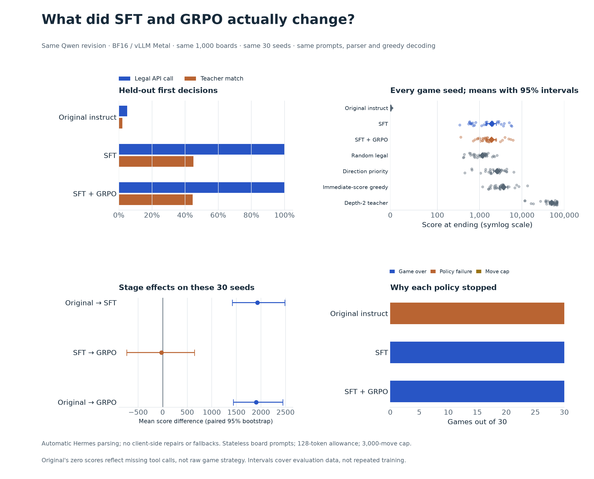

# Original Qwen, SFT and GRPO: matched checkpoint comparison

The matched controls show a clear improvement in executable tool use after SFT,
and **no reliable additional gameplay benefit from this GRPO run**. Mean game
scores were **1,929 after SFT** and **1,904 after GRPO**. The paired difference was
−24.8 points, with a 95% interval of **−731 to +647**: meaningful benefit and harm
both remain compatible with these 30 seeds.

The controls reuse the completed [GRPO benchmark](SERVED_EVALUATION.md) without
changing its measurements. All stages use the same agent loop, prompts, parser,
decoding, test boards and game seeds; the checkpoint weights change.



## Held-out first decisions

| Checkpoint | Legal executable calls | Teacher matches through calls |
| --- | ---: | ---: |
| Original instruct | 51/1,000 (5.1%) | 22/1,000 (2.2%) |
| SFT | 1,000/1,000 (100%) | 450/1,000 (45.0%) |
| SFT + GRPO | 1,000/1,000 (100%) | 445/1,000 (44.5%) |

The original model's other 949 replies had no recognized tool call. Of those,
899 were exact uppercase direction words, ignoring surrounding whitespace.
They were not executed: the fixed protocol requires a `move` function call and
does not add a text-direction fallback.

A separate offline diagnostic counts legal tool calls or these bare direction
words. It finds 950 interpretable, legal directions and 259 teacher matches
(25.9% of all test boards; 27.3% of interpretable replies). This shows why the
primary 2.2% figure must not be described as the original model's general 2048
reasoning accuracy. The diagnostic changes no primary record and does not
measure full games with a fallback controller.

SFT and GRPO differ on 83 directions: SFT alone matches the teacher on 31 boards,
and GRPO alone on 26. GRPO's net teacher-match difference is −0.5 percentage
points, with a paired source-game-bootstrap interval of −2.12 to +0.93 points.
Both match the teacher on 17/32 diagnostic GRPO-training boards. This does not
establish a distinct overfitting effect from GRPO.

## Thirty shared game seeds

| Checkpoint | Mean score at stop | Median | Genuine game overs | Policy failures |
| --- | ---: | ---: | ---: | ---: |
| Original instruct | 0 | 0 | 0/30 | 30/30 |
| SFT | 1,929 | 1,430 | 30/30 | 0/30 |
| SFT + GRPO | 1,904 | 1,410 | 30/30 | 0/30 |

Every original-model trial stopped before its first move because no tool call
was returned. Its zero scores measure interface failure in this agent, not
strategy under a more permissive controller. The original-to-SFT comparison
therefore includes interface compliance and does not isolate pure strategy.

Both trained checkpoints reached a highest tile of 512 and reached no 2048
tiles in 30 games. Neither hit the move cap or made an illegal action. Their
best scores were 5,764 after SFT and 6,152 after GRPO. The unchanged algorithmic
baselines averaged 1,160 for random legal play, 2,581 for direction priority,
3,634 for immediate-score greedy and 50,315 for the bounded teacher. Eleven
teacher trials reached the common move cap.

| Stage contrast | Mean score difference | Paired 95% bootstrap interval |
| --- | ---: | ---: |
| Original → SFT | +1,928.9 | +1,417 to +2,488 |
| SFT → GRPO | −24.8 | −731 to +647 |
| Original → GRPO | +1,904.1 | +1,439 to +2,444 |

GRPO scored higher than SFT on 19 seeds and lower on 11. Those changed
trajectories do not translate into a clear mean-score gain. The intervals
describe evaluation-seed variation for these checkpoints, not variation from
repeating training with new training seeds.

Median test-request latency was 0.680 seconds for SFT and 0.679 seconds for GRPO.
The original's 0.138-second median mostly reflects much shorter, non-call text
outputs and should not be interpreted as superior useful-action throughput.

## What to conclude

SFT made the policy usable with this tool interface and improved imitation of
the bounded teacher, including in the separate word-direction diagnostic.
These checkpoints still play below simple priority and greedy baselines.
The current GRPO stage changed behavior but has not demonstrated a reliable
additional gain under the matched serving protocol.

This is not evidence of reward hacking. No new score tampering or premature
policy stops were observed in the SFT/GRPO trials. The historical training exits
remain recorded, and their different parser/context/generation conditions remain
important limits. A further RL experiment should preserve these controls,
address the known rollout/parser and horizon issues, and reserve fresh games
for confirmation if these findings guide tuning.

All shared protocol and tokenizer checks passed. All **210 traces and 100,676
attempted moves** replayed exactly; original zero-move failures are included in
the trace count. Full stage metrics, paired contrasts and text-only diagnostics
are in `results/checkpoint-comparison-v1/analysis.json`. GRPO serving was restored
after both controls completed.

## Controls

| Stage | Artifact | Additional project training |
| --- | --- | --- |
| Original instruct | Pinned Qwen2.5-1.5B-Instruct | None |
| SFT | Full 8,000-example adapter merged into the same original checkpoint | 2,000 SFT updates |
| SFT + GRPO | Previously evaluated merged checkpoint | SFT followed by 100 GRPO updates |

“Original” means the vendor's instruction-tuned model before this project's
training, rather than a raw pretrained model. All serving artifacts use BF16
weights, with verified tokenizer/chat-template hashes shared across stages.
Original source weights, the SFT adapter and all merged master checkpoints remain preserved.

Each control uses the same 1,000 held-out boards, 32 diagnostic training-board
probes, 30 game seeds, prompts, legal-move observations, Hermes tool parser,
greedy decoding and 128-token allowance as GRPO. Gameplay resets the prompt for
each board and stops on the first malformed or illegal action. Scores at the
3,000-attempt cap are distinguished from genuine game over.

The four algorithmic baseline players are reused from their frozen, replayed
traces. Their policies and game seeds are unchanged; rerunning them would add
no information. Run folders stay separate:

- `results/served-base-v1/`: original-instruct control.
- `results/served-sft-v1/`: SFT-only control.
- `results/served-grpo-v1/`: completed GRPO/reference benchmark.

## Reproduction

The pipeline prepares non-overwriting local exports, validates their tensor
hashes, and serves one model at a time. It evaluates SFT first, original Qwen
second, then restores GRPO serving. It checks that frozen reference files are
unchanged. Runtime connection details and process records stay ignored.

```sh
.venv/bin/python scripts/run_checkpoint_comparison.py
```

Existing completed exports are verified and reused. Interrupted evaluations
resume with matching manifests; partial exports are protected from overwriting.
An exclusive local pipeline lock prevents duplicate runs. Network checks cover
the API and its internal engine listeners, not only the API bind address.

After both controls finish:

```sh
PYTHONPATH=src uv run --offline --managed-python --script scripts/analyze_checkpoint_comparison.py
```

The analysis verifies the shared test contract, replays all model and baseline
traces, and calculates paired stage differences. Score intervals resample 30
common seeds; teacher-agreement intervals resample 11 source-game clusters.
They do not capture variation from repeating training with new training seeds.

## Interpretation

The important contrasts are SFT minus original, GRPO minus SFT, and GRPO minus
original. An observed negative difference with a wide interval spanning zero
does not establish a reliable regression or equivalence. Performance differences
also do not, by themselves, establish reward hacking. These controls keep the parser and agent loop fixed;
they do not test the multi-turn training protocol or all deployment settings.
