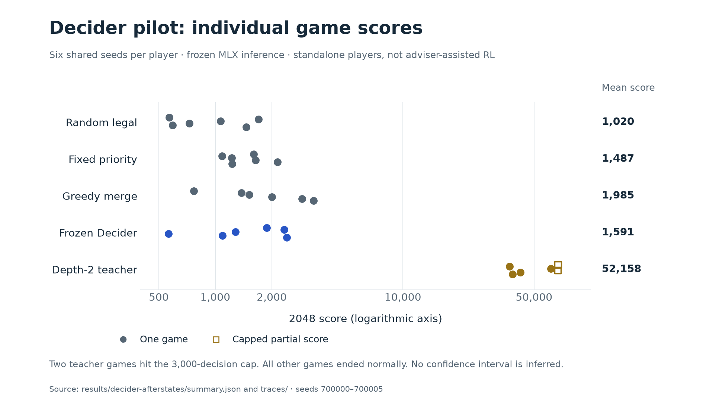
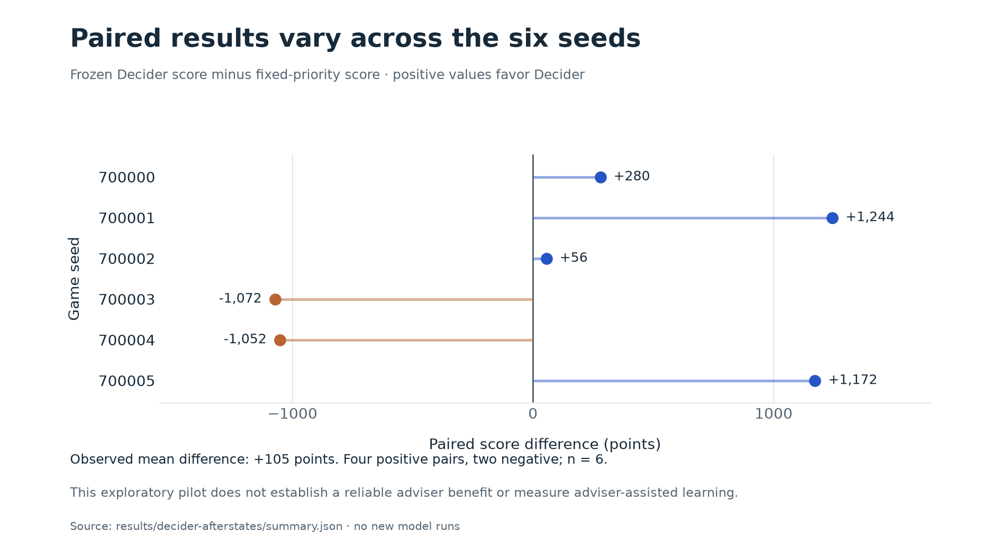

# Local Strands Decider pilot

## Finding

This pilot does **not establish a useful 2048 adviser benefit**. Decider can
choose legal moves, but its full-game results are much weaker than the teacher
and do not clearly improve on simple controls. The recommendation is to begin
the rented-GPU session with unassisted SFT and RL, then revisit the adviser only
if another experiment provides a stronger reason.

These are real local inference results. No model was fine-tuned for this pilot.

## Setup

- Machine: Apple M4 Mac mini, 24 GB unified memory, macOS 26.6.2.
- Backend: native MLX, frozen 2B Qwen3.5-based Decider checkpoint.
- Model/source/base revisions: `results/decider-provenance.json`.
- Working inference dependencies: `decider-macos-requirements.txt`.
- Initial prompt describes the game's rules and lists the current legal moves.
- Primary variant: each candidate includes the deterministic board after sliding
  and its immediate score gain. This uses known simulator transitions. It does
  not expose future random tiles or teacher action values to Decider.
- A separate directions-only diagnostic omits these afterstate descriptions.

## Primary position diagnostic

128 positions sampled reproducibly from validation games, not the test split.
All four directions are supplied as options; invalid moves are allowed as
candidate options so invalid-choice behavior can be measured.

| Metric | Observed |
| --- | ---: |
| Legal choice rate | 128/128 (100%) |
| Teacher first-choice agreement | 45/128 (35.2%) |
| Warm median request latency | 486 ms |
| Warm P95 request latency | 536 ms |
| First request latency | 1,397 ms |

The first-request value excludes server startup and weight downloads. Latencies
include the local HTTP request and response. They are workload-specific; this
prompt is longer than the short classification examples in the model card.

The legal move list and candidate validity flags were supplied by the simulator,
so this result does not show that Decider independently learned all game rules.
The teacher's action values often have near ties; first-choice agreement alone
does not establish game skill. The separate full-game pilot checks that outcome.

The directions-only variant used the same 128 validation boards and achieved
100% legal choices, 39/128 (30.5%) teacher agreement, and 270 ms warm median
latency. The afterstate variant matched the teacher more often but had higher
average relative teacher-value regret (3.55% versus 2.36%). These small surrogate
differences do not establish which prompt yields better full-game play; the
directions-only variant was not run through complete games.

## Paired-seed gameplay pilot

Six seeds, 700000–700005. Every policy receives legal actions only. The Decider
wrapper directly chooses a forced sole legal move without a model call because
the choice API requires at least two options. No solver overrides Decider's
choices. The game runs until terminal state or a 3,000-decision cap.

| Player | Mean score | Median score | Games reaching 2048 | Capped games |
| --- | ---: | ---: | ---: | ---: |
| Random legal | 1,020 | 898 | 0/6 | 0 |
| Fixed-priority legal | 1,487 | 1,414 | 0/6 | 0 |
| Greedy immediate merge score | 1,985 | 1,760 | 0/6 | 0 |
| Frozen Decider, afterstates | 1,591 | 1,580 | 0/6 | 0 |
| Depth-2 expectimax teacher | 52,158 | 51,848 | 6/6 | 2 |

Teacher scores for the two capped games are partial. All Decider games reached
terminal state; its largest tile was 256 in two games. Full traces are saved and
were replay-verified against the seeded simulator.



Each dot is an individual game; open squares identify the two capped teacher
games. The score axis is logarithmic so all five players fit on one figure.
Arithmetic means appear in the right-hand column; vertical offsets separate
individual seeds and do not encode an additional measurement.

Decider minus fixed-priority paired score differences were +280, +1244, +56,
-1072, -1052, and +1172. Six games are far too few to make a broad performance
claim. This also tests Decider as a standalone player, not whether an RL learner
can make selective use of its suggestions. An adviser benefit remains untested.



The paired view shows four positive differences and two negative differences,
including large swings in both directions. It presents the observed six games;
it does not establish that the mean difference will persist on new seeds.

Regenerate these figures directly from the saved summary and game traces:

```sh
uv run --managed-python --script scripts/plot_experiments.py
```

PNG and editable SVG versions are committed in `docs/figures/`.

## Artifacts

- `results/decider-afterstates/summary.json`: aggregate metrics and all scores.
- `results/decider-afterstates/predictions.jsonl`: raw choice probabilities,
  confidence, latency, legality, and teacher comparison for every diagnostic board.
- `results/decider-afterstates/traces/`: all 30 game traces across five policies.
- `results/decider-directions/`: separate directions-only diagnostic.

The prompts and candidate construction are in `src/posttrain2048/decider.py`.
No claim is made that generic classification confidence estimates the chance of
winning 2048. Follow `LOCAL_COMMANDS.md` to rerun the benchmark.
