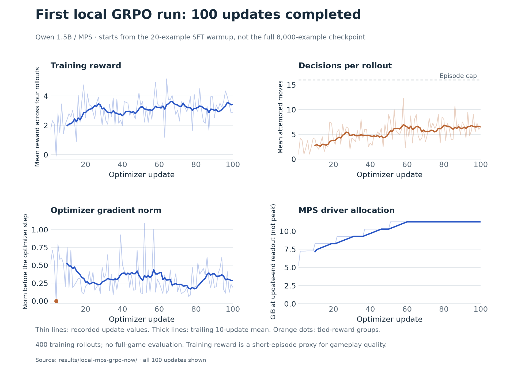

# First local 2048 GRPO run: 100 updates

The first GRPO job completed all 100 updates on the Apple M4 through TRL/MPS.
Its adapter was saved and reloaded, with identical validation predictions.
The pipeline then automatically continued into the full 8,000-example SFT epoch;
post-SFT GRPO remains queued.

This first run starts from the **20-example SFT warmup**, not the full-data SFT
checkpoint. It establishes a working stateful learning loop, not strong 2048 play.



Thin lines show recorded values; thick lines show a trailing 10-update mean.
The reward and decision curves use all four rollouts in each group. The memory
curve records update-end driver allocation, not peak or total system memory.

## Observations

- **100 optimizer updates, 400 rollouts, 2,115 attempted moves.** All saved moves,
  spawns, score gains, and rewards were verified by replaying the seeded simulator.
- Training took **81.9 minutes**, excluding loading and
  validation generation. This measures this particular run, not a general benchmark.
- Mean group reward was **2.424** across the
  first 20 updates and **3.229** across the
  final 20. These are descriptive windows; changing boards, sampled moves, and
  random tile spawns prevent treating this as a controlled improvement estimate.
- **1/100 groups** had identical rewards and supplied no relative policy-gradient
  signal. Other updates had nonzero gradients; all recorded gradients were finite.
- **371/400 rollouts stopped early** before the decision budget was exhausted.
  Mean attempted moves per rollout was **5.29**, against a cap of 16. Continuing
  to call the move tool is still a limitation of this policy.
- Adapter weights changed (maximum absolute change **0.000897**),
  and saved adapter tensors and fresh-model reload predictions matched exactly.

## Small validation-board check

The same 12 validation boards were evaluated greedily before and after RL.
Their legal move lists are included in the prompt. Teacher agreement measures
matching the teacher's first choice, not optimality or full-game strength.

| Checkpoint | Legal outputs | Teacher first-choice agreement |
| --- | ---: | ---: |
| SFT warmup | 12/12 | 2/12 |
| After this GRPO run | 12/12 | 5/12 |

These 12 boards are too few to establish a reliable generalization improvement.
**No full-game evaluation has been performed for this checkpoint.** No win rate
or successful adviser-assisted learning is claimed.

## Reproduce and inspect

- [Configuration, gradients, checkpoint path, and predictions](../results/local-mps-grpo-now/grpo-summary.json).
- [Metrics for all 100 updates](../results/local-mps-grpo-now/grpo-metrics.jsonl).
- [All sampled episodes and tool messages](../results/local-mps-grpo-now/grpo-episodes.jsonl).
- [Observation and unexecuted-tail mask audits](../results/local-mps-grpo-now/grpo-mask-audit.jsonl).
- [Training runner](../scripts/train_local.py).

The model, revision, LoRA setup, reward, and queue are described in
[the local run notes](LOCAL_TRAINING_RUN.md). Reward is
`log1p(score gained) - 0.1 * invalid attempts`; it is a short-episode proxy.

Regenerate the PNG and SVG without loading a model:

```sh
uv run --managed-python --script scripts/plot_local_training.py
```
