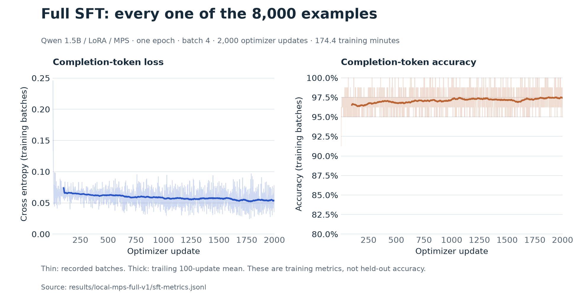
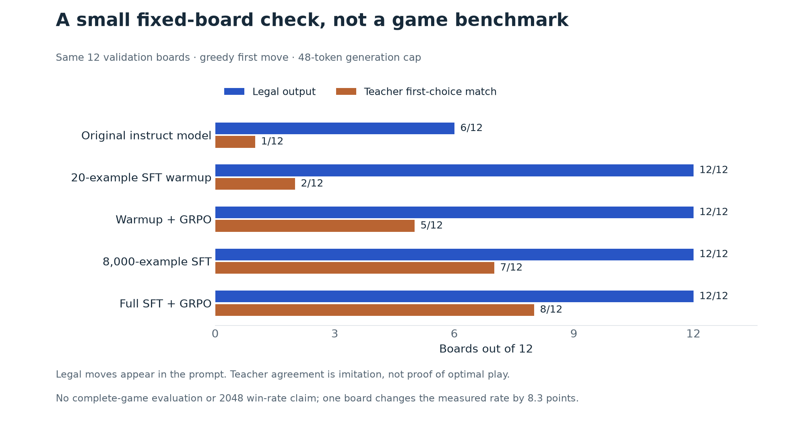
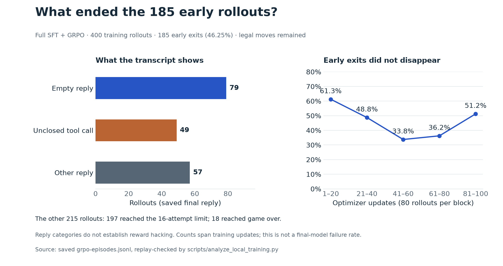

# Full local SFT and GRPO completed

All three queued jobs finished on the Apple M4 / 24 GB Mac. No rented GPU or
paid service was used.

| Job | Starting point | Completed work | Training time |
| --- | --- | --- | ---: |
| First GRPO comparison | 20-example SFT warmup | 100 updates / 400 rollouts | 81.9 min |
| Full SFT | Original Qwen instruct model | 8,000 examples / one epoch / 2,000 updates | 174.4 min |
| Post-SFT GRPO | Full SFT adapter | 100 updates / 400 rollouts | 184.9 min |

The first GRPO adapter does **not** feed into full SFT. Total optimizer training
time was 7.35 hours, excluding setup, loading and validation checks.

## Training observations



All 8,000 selected IDs are unique and exactly match the training split. The
2,000 batch-four updates end at epoch 1. Completion-token loss averaged 0.0739
over the first 100 updates and 0.0538 over the final 100. These are training
measurements, not held-out accuracy.


| Short-rollout measurement | After warmup | After full SFT |
| --- | ---: | ---: |
| Replayed attempted moves | 2,115 | 4,874 |
| Mean attempts per rollout, cap 16 | 5.29 | 12.19 |
| Early exits | 371/400 | 185/400 |
| Mean reward, first 20 updates | 2.424 | 3.912 |
| Mean reward, final 20 updates | 3.229 | 4.289 |
| Tied-reward / zero-gradient updates | 1/100 | 0/100 |

The full-SFT policy sustained longer tool interactions, but still stopped early
in 46.25% of its rollouts. Its 360 invalid-decision penalties comprise 185 early
exits and 175 invalid moves. No tool-execution errors were recorded. Longer valid
episodes naturally accumulate more score under this reward; the reward difference
does not establish stronger long-term strategy.

Every saved board, move, spawn, score and reward replayed correctly in the seeded
simulator. Gradients were finite throughout, with nonzero norms on all 100
post-SFT GRPO updates. Adapter serialization and fresh-model prediction reloads
matched exactly. Maximum recorded GRPO driver allocation was about 11.29 GiB,
an update-end snapshot rather than peak or total system memory.

## Evaluation limits



Full SFT matched the teacher on **7/12** fixed validation boards; post-SFT GRPO
matched on **8/12**. Both produced legal first moves on all 12. Legal moves are
listed in the prompt, and generation is greedy with a 48-token cap. Teacher
agreement measures imitation; one board changes this rate by 8.3 percentage points.

GRPO repeatedly used 32 early-game training boards with four seeded rollouts per
group and a 16-attempt horizon. There was one training seed per path. At training
completion, complete-game and test-split evaluation remained unmeasured. A later
[served-model benchmark](SERVED_EVALUATION.md) evaluated 1,000 held-out boards and
30 new game seeds. A subsequent [matched checkpoint comparison](CHECKPOINT_COMPARISON.md)
adds original-instruct and SFT controls. An adviser-benefit study and a PPO
comparison remain unmeasured.

## Reward exploitation audit

No score tampering was found: all recorded rewards match replayed simulator
scores, rather than score claims in assistant text. This does not rule out
behavior that exploits the reward's incentives.

There is a stopping loophole: ending early incurs only a 0.1 penalty while
retaining accumulated score reward. Of 185 post-SFT early exits, 180 retained
positive absolute reward and 25 were highest-reward rollouts in their group
(including ties). Positive absolute reward alone is not a GRPO advantage.

The final assistant replies in those 185 cases were 79 empty tails, 49 unclosed
tool calls and 57 other text replies. These categories indicate output-format
and termination problems; they do not prove intentional stopping or establish
why a reply ended. No post-terminal or unexecuted structured tail calls were
recorded in this run.



These 185 exits are 46.25% of the 400 short training rollouts, not 185 completed
games. They span changing checkpoints across 100 updates; 46.25% is not a
measured failure rate for the final checkpoint. The other outcomes were 197
nonterminal rollouts at the 16-attempt limit
and 18 actual game overs. Early exits averaged 8.78 attempted moves. Across
successive blocks of 20 updates, the early-exit counts were 49, 39, 27, 29 and 41
out of 80 rollouts each; this was not a steadily increasing stopping pattern.

The recorded GRPO advantages were positive for 75 early exits and negative for
110. Thus, some incomplete rollouts were reinforced relative to their group,
while most were penalized relative to their group. This does not show that
stopping itself caused the high reward: the advantage applies to the trajectory,
including its earlier successful moves.

For example, update 37 included an exit after 13 attempted moves, 384 score
gained and reward 5.8532. Its final reply proposed `DOWN` in a tool-call wrapper
without a closing tag, so the move was not executed. The saved transcript
does not retain per-turn finish reasons or raw generation IDs; it cannot
distinguish an EOS, output truncation or other parsing failure in every case.
Training used a 48-new-token per-reply cap. That cap is a possible contributor,
not an established explanation for all exits. The SFT examples demonstrate
single-turn board-to-move outputs, whereas these RL rollouts require repeated
tool calls in a growing conversation; this is another hypothesis to test.

A later static [serving-parser audit](SERVED_EVALUATION.md#parser-differences-matter)
found that 33 of the 49 unclosed replies contain valid, legal moves recognized
by vLLM's more permissive Hermes extraction rule. They remain early exits in
the historical training run. Parser behavior, along with context and decoding,
prevents directly comparing training exits with served API failure rates.

The short horizon also rewards immediate merges without measuring the later
board's survival. Treat early stopping and short-horizon optimization as reward
design weaknesses, not demonstrated learned exploitation. Reward hacking does
not require conscious intent. The matched serving comparison now covers SFT and
post-SFT policies on the same held-out games; it finds no reliable GRPO score
gain. Native multi-turn rollout diagnosis remains important before another RL
run or reward change. Keep the checkpoints and reward definition as baselines.

## Merged checkpoint

The final adapter was merged once into the pinned original base, producing this
local FP32 Hugging Face master checkpoint:

```text
checkpoints/local-mps-full-v1/merged-fp32/
```

It includes sharded weights, tokenizer, chat template and generation config.
Original adapters are retained; all model weights remain excluded from Git.
Training used the Mac GPU through MPS; merging and export verification used CPU.
FP32 export avoids rounding the low-rank update into BF16 weight storage at this
stage. It does not add precision to the original pretrained weights.

A separate BF16 serving copy is now configured in [vLLM Metal](LOCAL_SERVING.md).
All 338 saved tensors match their intended casts, and the FP32 master's hashes
are unchanged. One unconstrained validation request returned a legal `UP` tool
call. That single request verifies serving and parsing, not BF16 numerical parity
or game quality; the later [evaluation](SERVED_EVALUATION.md) measures held-out
decisions and gameplay separately.

On one validation prompt, maximum final-position logit difference between FP32
adapter and merged evaluation was **0.00020051**, within `atol=0.0005` and
`rtol=0.0001`; the next-token argmax agreed. Reloading the saved merged checkpoint
reproduced its logits exactly. This verifies export arithmetic, not whole-sequence
or BF16 serving equivalence. Backend/dtype changes still need gameplay evaluation.

## Configuration and reproduction

Base: `Qwen/Qwen2.5-1.5B-Instruct`, revision
`989aa7980e4cf806f80c7fef2b1adb7bc71aa306`. BF16 MPS training, no CPU operator
fallback, rank-4 LoRA on q/v, alpha 8, and 544,768 trainable parameters. SFT uses
completion-only loss and learning rate 2e-4. GRPO uses learning rate 2e-5,
`beta=0`, native tool rollouts and `log1p(score gained) - 0.1 * invalid attempts`.
Simulator observations and unexecuted tail calls are masked from the loss.

Inspect the [raw measurements](../results/local-mps-full-v1/),
[replay analysis](../results/local-mps-full-v1/analysis.json),
[merge verification](../results/local-mps-full-v1/merge-report.json), and
[pinned environment](mps-trl-requirements.txt).

```sh
uv run python scripts/analyze_local_training.py
uv run --offline --managed-python --script scripts/plot_full_training.py
```

PNG and editable SVG figures use saved measurements without loading a model.
`scripts/merge_local_adapter.py` exports with the training environment and refuses
to overwrite an existing checkpoint or report. The separate educational artwork
remains local and untracked at the user's request.
