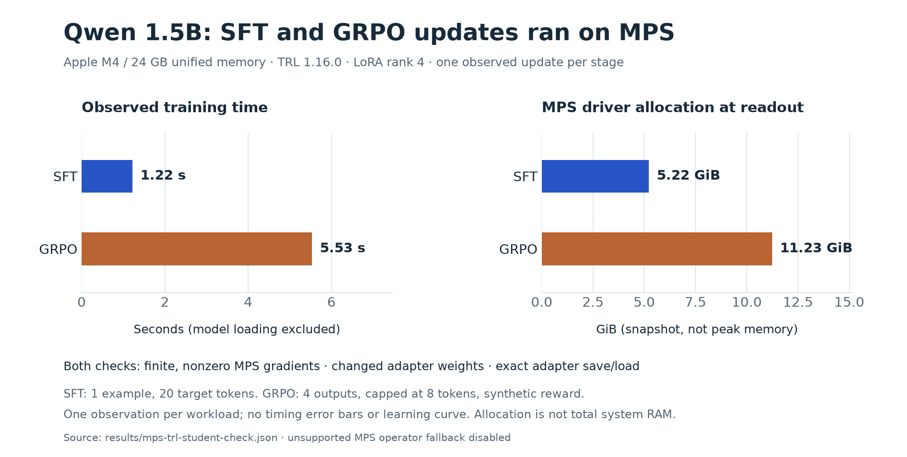
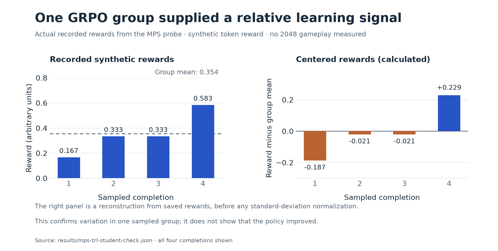

# Local TRL / MPS compatibility check

Checked on 2026-10-25: Apple M4, 24 GB unified memory, macOS 26.6.2.
Both SFT and GRPO performed a real LoRA optimizer update on MPS, first using a
tiny random Qwen2 and then the actual `Qwen/Qwen2.5-1.5B-Instruct` checkpoint.
These are compatibility probes, not completed post-training experiments.

## Measurements at a glance



Each bar is one recorded observation from the actual 1.5B student check. The
workloads differ: SFT updates on one example; GRPO generates four short outputs
before updating. Timing excludes model loading. Memory is a driver-allocation
snapshot taken after training, not a peak-memory measurement or all system RAM.
These measurements establish feasibility for this small check, not sustained
throughput or an expected full-training cost.



All four synthetic rewards are shown. The right panel is calculated from the
saved rewards by subtracting their group mean, before any standard-deviation
normalization. The different signs show the relative signal available to this
update. This is one group, not a reward learning curve or game-skill evaluation.

Regenerate both figures, and the Decider figures, without running a model:

```sh
uv run --managed-python --script scripts/plot_experiments.py
```

The script reads the committed JSON measurements and writes PNG and SVG files
to `docs/figures/`. Dependencies are pinned in the script's metadata.

## Evidence

- [Tiny model report](../results/mps-trl-check.json).
- [Actual 1.5B student report](../results/mps-trl-student-check.json).
- [Reproducer](../scripts/check_trl_mps.py).
- [Exact environment snapshot](mps-trl-requirements.txt).

TRL 1.16.0, PyTorch 2.14.1, Transformers 5.20.2, PEFT 0.21.2,
Accelerate 1.15.0, Datasets 5.1.0, CPython 3.11.15.
Student and tokenizer revision: `989aa7980e4cf806f80c7fef2b1adb7bc71aa306`.

Each check verifies:

1. The trainer selects `mps`; nonzero, finite adapter gradients live on `mps:0`.
2. A real optimizer step changes trainable weights.
3. The loss is finite. A near-zero first GRPO loss is expected when centered
   advantages cancel; the nonzero gradients and changed weights are checked
   separately.
4. Adapter tensors survive save/load exactly. Temporary adapters are removed
   after checking; the probe does not save a student for gameplay.

`PYTORCH_ENABLE_MPS_FALLBACK=0` is set before importing PyTorch. CPU tokenization,
data handling, logging, and serialization still occur normally. This setting
disables silent CPU execution of unsupported MPS tensor operators.

## Scope

- LoRA rank 4 on `q_proj` and `v_proj`; the actual student has 544,768 trainable
  adapter parameters. The frozen pretrained base is loaded in bfloat16 with
  standard SDPA attention. No vLLM, Liger, Triton, or torch.compile is used.
- SFT prepares 20 actual training examples, but performs just one update with
  batch size 1. Inputs are pretokenized to preserve the previously audited chat
  template exactly, with 20 move-call target tokens and masked prompt tokens.
  This is not the planned 20-example overfit experiment.
- GRPO samples four completions, capped at eight tokens each, from an actual
  rendered 2048 prompt. Reward is deliberately synthetic: `sum(token_ids) % 13 / 12`.
  Its purpose is to produce a variable group signal and exercise generation,
  log probabilities, loss, and gradients. It is not a useful game objective.
- Both stages start independently; GRPO does not use the probe's SFT adapter.
  This is not an SFT-to-RL learning result.
- The stateful game wrapper, environment observation masking, 16-decision
  episodes, full-game evaluation, and sustained training throughput remain
  unverified. One-update timings in the JSON exclude model loading and cannot
  be extrapolated into a reliable training budget.
- Recorded MPS driver allocation is a point-in-time value, not peak memory or
  all unified memory consumed by the process.

## Reproduce

Use the isolated environment so the core lab and Decider dependencies stay intact:

```sh
uv python install 3.11
uv venv --managed-python --python 3.11 .venv-trl-mps
uv pip install --python .venv-trl-mps/bin/python -r docs/mps-trl-requirements.txt

# Download/cache the original training checkpoint, not a GGUF or MLX conversion.
.venv-trl-mps/bin/hf download Qwen/Qwen2.5-1.5B-Instruct \
  --revision 989aa7980e4cf806f80c7fef2b1adb7bc71aa306

.venv-trl-mps/bin/python scripts/check_trl_mps.py
.venv-trl-mps/bin/python scripts/check_trl_mps.py --student \
  --output results/mps-trl-student-check.json
```

The original pyenv CPython 3.11.8 lacked `_lzma`, preventing Datasets imports.
Using managed CPython fixed that local packaging problem without changing the
existing environments. It was not a TRL or MPS bug.

## Contribution opportunities

MPS works in these configurations today; this is not evidence that a new MPS
backend is needed. Useful potential contributions include small regression
tests, a verified Apple Silicon configuration guide, and fixes for failures
encountered during the real game integration. A candidate bug needs its own
reproduction and duplicate check before an upstream proposal.

TRL already merged [MPS cache handling](https://github.com/huggingface/trl/pull/5799)
and a [portable non-Triton loss-kernel path](https://github.com/huggingface/trl/pull/7669).
Neither is an unclaimed opportunity for us to reimplement. Native MLX would
require a larger design spanning model execution, autodiff, optimization,
generation, adapters, and checkpointing; data and tokenization can be reused.
The [contribution guide](https://github.com/huggingface/trl/blob/main/CONTRIBUTING.md)
requires first-time contributors to discuss an issue and get it assigned
before submitting a PR. No upstream issue, comment, or PR was posted by this check.
