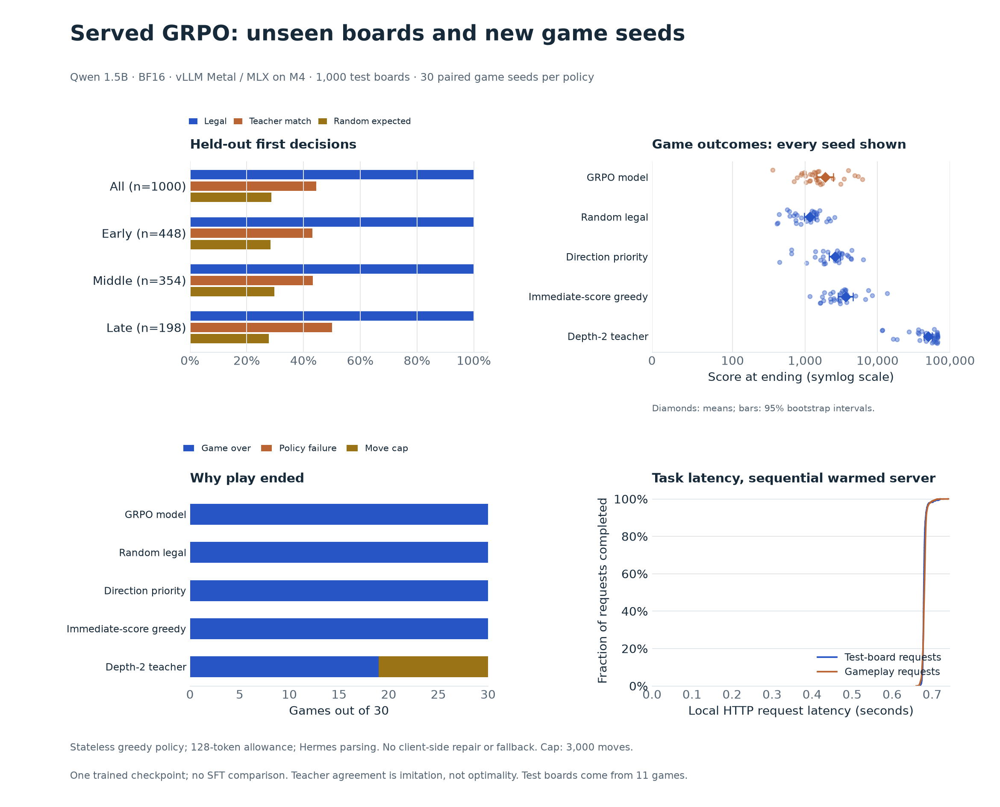
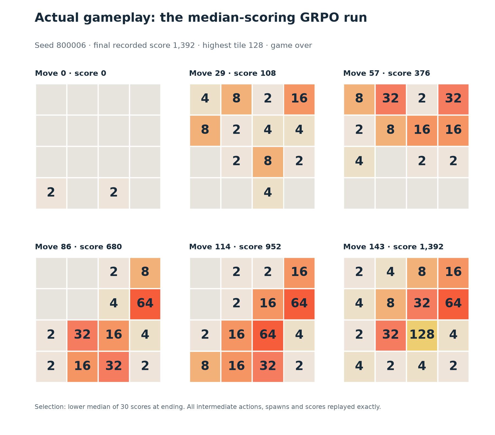

# Served GRPO evaluation

The completed GRPO policy produced executable legal moves on all 1,000 held-out
boards, matched the teacher on 44.5%, and averaged **1,904 points over 30 new
games**. It beat random legal play but scored below fixed direction-priority and
immediate-score greedy baselines. The protocol below was fixed before requesting
test positions; there was no prompt or decoding tuning during the run.

The post-trained artifact is the Qwen policy model: LoRA weights were updated,
then merged for serving. The evaluated agent combines that model with prompting,
tool parsing and a fixed Python simulator loop. Gameplay scores measure this
assembled system; the simulator and tool implementations were not trained.



## Held-out first decisions

| Test boards | Legal move | Teacher first-choice match | Random-legal expected match |
| --- | ---: | ---: | ---: |
| All 1,000 | 1,000/1,000 | 445/1,000 (44.5%) | 28.73% |
| Early: 448 | 448/448 | 193/448 (43.08%) | 28.31% |
| Middle: 354 | 354/354 | 153/354 (43.22%) | 29.76% |
| Late: 198 | 198/198 | 99/198 (50.0%) | 27.82% |

The random-legal reference is the expected first-choice match rate for uniformly
sampling each board's legal moves: the mean of `1 / number_of_legal_moves`.
It is not a separately sampled model result. The model exceeds that reference
on these boards while leaving substantial room to imitate the bounded teacher.
The prompt explicitly lists legal moves, so legality alone is a weak strategy test.
The teacher-match 95% bootstrap interval is 37.45–50.77%, resampling the 11 source
games. Counting exact ties in the teacher's heuristic value gives 446/1,000 rather
than 445/1,000. Neither metric establishes optimal actions.

The seen-board diagnostic matched the teacher on 17/32 GRPO training boards
(53.13%), all early-stage positions. The comparable held-out early-stage match
rate is 43.08%. The seen set is small and selected; this descriptive gap alone
does not establish overfitting or show that GRPO caused it.

Observed request latency on the warmed server was about 0.679 seconds at the
median and 0.687 seconds at the 95th percentile. The 5,239 gameplay requests had
median latency 0.681 seconds and 95th-percentile latency 0.688 seconds. These
include local HTTP, prefill and generation; they are not maximum-throughput tests.

## New seeded games

| Policy | Mean score | Median score | Highest tile | Reached 2048 | Move caps |
| --- | ---: | ---: | ---: | ---: | ---: |
| Served GRPO | 1,904 | 1,410 | 512 | 0/30 | 0 |
| Random legal | 1,160 | 1,196 | 256 | 0/30 | 0 |
| Direction priority | 2,581 | 2,662 | 512 | 0/30 | 0 |
| Immediate-score greedy | 3,634 | 3,084 | 1024 | 0/30 | 0 |
| Depth-2 teacher | 50,315 | 58,548 | 4096 | 26/30 | 11 |

All 30 model games reached genuine game over, with zero malformed responses,
illegal moves or early policy stops. The mean score's 95% seed-bootstrap interval
is 1,439–2,444. The best model game scored 6,152; the worst scored 356.

Seed-paired mean score differences were **+744** against random legal play
(95% interval +218 to +1,340), **−677** against direction-priority (−1,177 to −225),
and **−1,729** against greedy (−2,867 to −760). These intervals describe game-seed
variation for this fixed checkpoint, not uncertainty from retraining the model.

The teacher's 11 capped games were not complete game overs. All policies shared
the same 3,000-attempt cap, and the table reports scores when play ended or hit
that cap. No model run reached a 2048 tile; with only 30 games, zero observations
is not proof of a zero underlying success rate (95% Wilson interval 0–11.35%).



The replay figure uses the lower of the two middle scores, selected by final
recorded score and then seed. It shows seed 800006, score 1,392 and highest tile
128, rather than selecting the best run as an illustration.

## What this establishes

The served policy follows the executable-action interface reliably in this
stateless setup and imitates some of the solver's preferences. Its gameplay
strategy still falls short of straightforward fixed baselines. This is a useful
deployment baseline, not evidence of solver-level performance or a GRPO gain.

Poor scores alone do not establish reward hacking. No premature stops occurred
here, and every score came from the simulator. However, the parser, conversation
history, decoding and output budget differ from training; this run cannot resolve
what caused the historical 185 exits. A matched SFT-only and original-model
comparison is still needed before attributing gains or regressions to GRPO.

All 150 model/baseline traces and **95,414 attempted moves** replayed exactly.
Every test ID and recomputed teacher first-choice label was checked. Saved
measurements are in `results/served-grpo-v1/`; `analysis.json` contains the
intervals, static parser audit and resampling details.
`provenance.json` records code/library hashes, runtime versions and the 6,271
model requests. Public game JSON is compactly serialized with every parsed value
preserved; complete HTTP records and original formatting remain local.

## Parser differences matter

These legality counts measure executable calls returned by the served API,
including its automatic Hermes parser. The installed non-streaming parser
accepts valid JSON after an opening tool tag even when the closing tag is absent.
It does not require the stricter raw wrapper used by the training tool loop.

A static audit of the 185 saved training early-exit replies finds 33 legal move
calls that the Hermes extraction rule would recognize. All 33 are among the 49
unclosed replies. The native training loop did not execute those moves. This is
an agent-stack difference, without any model-weight change. It is not evidence
that those counterfactual rollouts would finish or earn more score.

No client-side repair or fallback is applied in this benchmark, but automatic
parser behavior is part of the measured system. Raw generated closing-tag
correctness is not exposed by the normal parsed chat response and is not claimed.

## Fixed protocol

- Model: the BF16 serving copy of the merged Qwen2.5-1.5B-Instruct checkpoint;
  tensor hashes are recorded in `results/served-grpo-v1/manifest.json`.
- Backend: vLLM Metal 0.32.0 with MLX on Apple M4, 24 GB unified memory.
- Positions: all 1,000 test examples from 11 held-out source games. The dataset
  hash is checked against the saved data audit. Report early/middle/late boards
  separately, because their difficulty and distribution differ.
- Seen diagnostic: all 32 boards used by GRPO, reported separately from the test
  set. This small, selected early-board set is not a representative training set.
- Gameplay: 30 new seeds reserved in the dataset plan, shared across GRPO,
  random legal, direction-priority, immediate-score greedy and depth-2 teacher.
- Prompt: the existing system instruction, legal moves, tool schema and full
  current board. Each move starts a fresh conversation. Board state is sufficient
  for the game transition; this protocol avoids growing history and context limits.
- Decoding: greedy, 128-token allowance, automatic tool choice, no forced grammar,
  correction, retries or fallback moves. Schema errors and illegal directions stop
  the model's game and count as policy failures, separately from natural game over.
- Game safety cap: 3,000 attempted moves per policy and seed. Capped games are
  labeled, and score at ending includes failures and caps rather than pretending
  that every recorded game reached game over.
- Latency: one sequential client, warmed server, HTTP request duration including
  prefill and generation. This is task latency, not maximum serving throughput.

## Reproduction

Keep the running server's connection settings in ignored local configuration.
Do not add concrete ports, credentials, process IDs or raw runtime records to Git.

```sh
. .local/serving.env
.venv/bin/python scripts/evaluate_served_model.py --port "$PORT" --run served-grpo-v1
```

Use a new run name for a new experiment. Existing output is protected from
overwriting; `--resume` validates the same manifest, skips completed positions and
games, and restarts only an interrupted game from its seed. A local lock prevents
concurrent benchmark processes. Complete HTTP responses and runtime status stay
in ignored `.local/served-grpo-v1/`; saved public records omit connection details.

```sh
PYTHONPATH=src uv run --offline --managed-python --script scripts/analyze_served_evaluation.py
```

The analysis replays every game trace and checks every test ID and teacher label.
Its uncertainty intervals resample source games for test-board agreement and pair
game seeds across policies for score differences. They do not include uncertainty
from repeating model training.

## Interpretation limits

This run evaluates one checkpoint. Without a matching SFT-only evaluation, it
cannot establish that GRPO caused a benefit, overfitting or reward exploitation.
Teacher agreement measures imitation of a bounded solver, not optimal play.
The 1,000 positions are correlated within 11 games, not 1,000 independent trials.

Fresh-prompt greedy gameplay with a 128-token allowance differs from sampled,
multi-turn GRPO with 48 tokens per reply. Its policy-failure rate must not be
compared directly with the 185 early exits aggregated during training. Preserve
this run as the baseline; tuning on these findings requires new held-out games
for a later confirmation.
